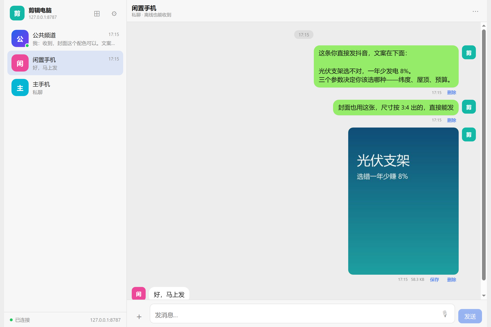
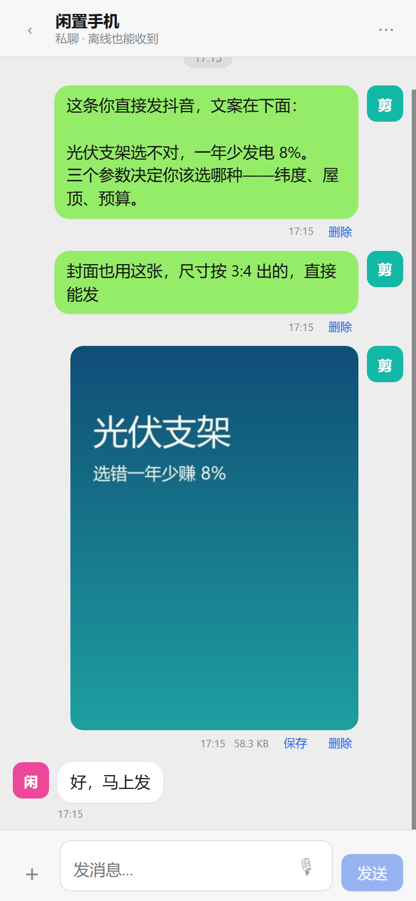
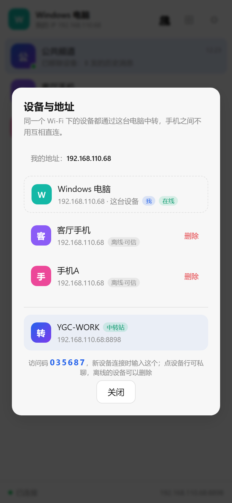
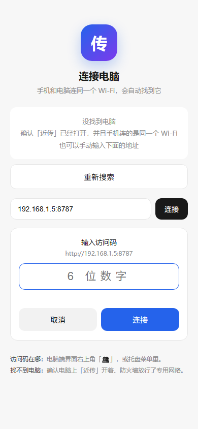

# 近传 NearDrop

**一个只为「自己的一堆设备」服务的局域网传输工具。** 只走局域网，不经过任何云服务器，所有消息和文件都落在你自己的电脑上。

---

## 为什么要做这个东西

我手上有三台以上的设备：一台干活的电脑、一台主力手机、一台准备专门用来发抖音的闲置手机，偶尔还有平板。它们**品牌各不相同**——Windows 电脑、华为、荣耀、红米，系统生态各管各的，厂商自带的互传功能只认自家产品，一旦跨品牌就全废。

我的日常是：电脑上剪好视频、写好文案、做好封面图 → 丢到那台闲置手机 → 用闲置手机上的抖音号发布；有时候手机在外面拍到的素材，还得反向传回电脑再加工。**一天来回好几趟。**

试过的路都不太顺：

- **微信/QQ 传文件**：要过服务器，视频被压缩，还得登同一个号、来回切账号，历史记录翻起来费劲
- **网盘**：上传下载两遍，几百兆的视频等半天，免费的还限速
- **LocalSend / 快传这类点对点工具**：方向是对的，但**要求两台设备同时开着、同时点确认**。手机在充电没解锁，就传不过去；传完也没有任何记录，找不回来
- **各种「多端协同」软件**：基本都要收费订阅，或者绑死在某一个品牌的生态里

所以我干脆自己写了一个。**需求就一句话：把我所有设备连成一个只在自家 Wi-Fi 里存在的群，像用微信一样方便，但数据不出门、不要钱、不限速、不压缩。**

于是有了近传。

## 它解决的是什么问题

绝大多数传输工具是「**点对点的一次性搬运**」——A 递给 B，递完就完了。近传是「**以一台电脑为中转站的多人协同**」：

```
        ┌───────────────────────────────┐
        │   中转站（你的电脑）            │
        │   FastAPI + SQLite            │
        │   消息和文件都存这里            │
        └───┬───────────┬───────────┬───┘
            │           │           │
      ┌─────▼────┐ ┌────▼─────┐ ┌───▼──────┐
      │ 电脑端    │ │ 主力手机  │ │ 闲置手机  │
      │ 做内容    │ │ 随手收发  │ │ 发抖音    │
      └──────────┘ └──────────┘ └──────────┘
                  同一个 Wi-Fi 内
```

多出来的这一层，换来的是点对点工具给不了的东西：

| | 点对点工具（LocalSend 等） | 近传 |
|---|---|---|
| 传输模式 | 两台设备必须同时在线、同时确认 | **异步**：发完就关，谁上线谁补收 |
| 历史记录 | 传完即消失 | **永久保留**，重启电脑也在，能翻能搜 |
| 多设备 | 一对一搬 | **公共频道**广播 + **私聊**定向，一对多天然支持 |
| 手机不在手边 | 发不了 | 先发到电脑上存着，回头开机再收 |
| 电脑关机 | 断开 | 消息不丢，开机自动补 |
| 收下的视频能不能发抖音 | 存下载目录，抖音选不到 | **直接进系统相册**，抖音选素材直接能选 |
| 换网络 | 重新配对 | **认设备不认 IP**，换 Wi-Fi 自动连回 |
| 费用 / 账号 / 限速 | 部分收费 | 全免费、无账号、无容量限制、原图原码不压缩 |

核心是三个词：**私有**（数据只在你家电脑上）、**异步**（不用两台设备同时在场）、**多端**（一次发给所有设备，也能只发给一台）。

---

## 先看一眼

演示视频：**[交付/近传-产品介绍.mp4](交付/近传-产品介绍.mp4)**（75 秒，1080p，带配音字幕）

**电脑端** —— 左边公共频道和每台设备的私聊，右边是聊天区



**手机端** —— 和电脑端同一套界面，视频点保存直接进相册



**设备与地址** —— 每台设备的名字、IP、在线状态；离线设备可以一键删除




---

## 它是什么

```
┌─────────────┐        ┌──────────────────┐        ┌─────────────┐
│  电脑 EXE   │◄──────►│  中转站（电脑）   │◄──────►│  安卓 APK   │
│  做内容     │  局域网 │  FastAPI+SQLite  │  Wi-Fi │  闲置手机    │
└─────────────┘        │  消息/文件都存这  │        └─────────────┘
                       └──────────────────┘               ▲
                                ▲                        │
                                └────────────────────────┘
                                      主手机 / 平板 / 任何浏览器
```

和 LocalSend、快传这类工具的区别：

| | LocalSend / 快传 | 近传 |
|---|---|---|
| 需要两台设备同时开着 | 是 | **否**，谁离线谁上线补收 |
| 有聊天记录 | 无 | 有，重启电脑也在 |
| 手机不在手边 | 发不了 | 先发过去，回头开机就能收 |
| 电脑上能翻历史 | 不能 | 能 |

## 功能

- **公共频道**：发一次，所有设备都能看到（电脑做好素材，两台手机都能拿）
- **私聊**：只发给某一台设备（只丢给闲置手机）
- **五种消息**：文字、图片、语音、视频、任意文件
- **直接存相册**：APK 里点「保存」，图片视频落到 `DCIM/Camera`（图库「相机」相册），抖音选素材直接能选到
- **全屏播放器**：视频在聊天里只显示封面 + 播放按钮，点开才是全屏播放，可暂停、拖进度、横屏、直接下载
- **长按消息**：长按文字消息整段选中，弹出「复制 / 删除」，跟微信一样
- **保存后一键定位**：存完的提示条上有「打开」，点了直接跳到文件管理器的那个目录；设置里也能随时打开下载目录或相册目录
- **离线不丢**：文件和消息存在电脑上，手机没开机也能先发
- **语音**：APK 用原生录音（浏览器在 http 下录不了音，这是浏览器的限制）
- **免输 IP**：APK 会自动在局域网里找电脑；换了网络连不上旧地址时，**5 秒后自动退回扫描页**每 4 秒重搜
- **访问码**：6 位数字口令，接口与 WebSocket 全部校验令牌；本机 127.0.0.1 免密
- **记住设备**：输过一次访问码就发一张长期设备凭证，换 Wi-Fi / 换 IP 自动连回来，除非在电脑端移出
- **设备列表**：每台设备的名称 / 内网 IP / 在线状态 / 是否已信任，点一下直接进私聊；电脑端可「移出」
- **拖拽 / 粘贴**：电脑上直接把文件拖进窗口，或 Ctrl+V 粘贴截图

## 安装

### 电脑端

1. 双击 `近传 NearDrop.exe`
2. Windows 防火墙弹窗 → **必须点「允许访问」**（专用网络要勾上），否则手机连不进来
3. 浏览器会自动打开界面，右下角托盘出现蓝色图标，鼠标悬停能看到地址，例如 `http://192.168.1.10:8787/`

托盘右键菜单：

- 打开界面 / 复制地址 / 打开数据文件夹
- **开机自动启动**（勾上以后开机就在后台跑，不用管它）
- 退出

### 手机端

1. 装 `近传_1.0.9.apk`（允许安装未知来源应用）
2. 打开 App → 自动搜索电脑 → 点一下
3. 输入电脑上的 6 位访问码（托盘菜单 / 界面右上角「👥」里）
4. 搜不到就手动输入电脑托盘里的地址，如 `192.168.1.10:8787`

> 不想装 APK 也行：手机浏览器打开 `http://192.168.1.10:8787/` 效果一样，
> 只是保存视频会进「下载」目录而不是相册，语音也用不了（浏览器的限制）。

## 用法

- 左边是会话列表：**公共频道** + 每台设备的私聊
- 点 `＋` 发图片 / 视频 / 文件 / 拍照
- 点 🎙 录音，录完点「发送」
- 图片点开可以全屏看，底下「保存到相册」
- 每条文件消息下面有「保存」，电脑上是下载，手机上是存相册
- 手机上从聊天页左上角 `‹` 返回列表

## 数据在哪

```
C:\Users\<你>\AppData\Local\NearDrop\
├── neardrop.db     消息记录
├── files\          原始文件（图片、视频、语音、附件）
├── thumbs\         缩略图缓存
└── neardrop.log    运行日志
```

想备份就整个文件夹拷走。想清空就在聊天页右上角 `⋯` 里点清空。

## 常见问题

**手机搜不到电脑**
1. 确认手机和电脑在同一个 Wi-Fi（不是手机流量，也不是访客网络）
2. Windows 防火墙要允许「近传」，或者临时关掉防火墙试一下
3. 有些路由器开了「AP 隔离」，设备之间不能互访，去路由器后台关掉
4. 直接手动输入地址最省事

**电脑上打不开界面**
端口被占了，程序会自动换 8787→8788。看托盘图标提示的地址。

**语音录不了**
手机浏览器里录不了是正常的（浏览器不允许非 HTTPS 页面用麦克风）。装 APK 就有原生录音。

**视频保存后抖音找不到 / 华为图库看不到**
APK 里保存走 MediaStore，落盘到 `DCIM/Camera`（系统相机目录）—— 华为/荣耀图库只稳定索引这个目录，
早期版本存 `Pictures/近传`、`Movies/近传` 会出现「提示成功但相册里没有」。
浏览器版仍会到「下载」目录，抖音选不到，需先用文件管理器导入相册。

**换电脑 / 换 IP**
1.0.3 起不用手工改了：App 认的是电脑的固定编号（`server_id`），不是 IP。换网络后自动重新发现并免密连上。真想换一台电脑，就去设置里改「服务器地址」。

**点了保存，相册里要等一会儿才出现**
保存不是复制缓存，是重新从电脑拉一遍原文件（播放器边下边播，不留完整副本），大视频本来就要等。
1.0.5 及更早版本在点下去的瞬间就弹「已保存」，属于假提示，已修；
1.0.6 起走真实进度，1.0.7 起还会显示实时速度：`正在保存 42%` → 写入完成才提示「已存到相册（相机）」。

---

## 身份体系（v1.2.2）

三层身份，各管一段：

| 层 | 存在哪 | 作用 |
|---|---|---|
| `server_id`（电脑的固定编号） | 电脑 `settings` 表，首次启动生成 | 客户端靠它认出「还是那台电脑」，换 IP 不变 |
| `device_id`（设备的固定编号） | 安卓 SharedPreferences / 浏览器 localStorage | 电脑靠它认出「还是那台手机」，清缓存不丢 |
| `hw_id`（`ANDROID_ID`） | 系统提供 | 设备编号丢了（重装 App）时用来找回旧记录 |
| `device_token`（设备凭证） | 客户端按 `server_id` 存 | 免密凭据，输过一次访问码就下发，可撤销 |

- 首次连接：`POST /api/auth {code, device_id, hw_id, name}` → 电脑登记设备、打 `trusted=1`、下发 `device_token`
- 之后每次请求带 `X-ND-Device` + `X-ND-Device-Token`，校验通过即免密
- 换网络：`/api/health` 拿到 `server_id` → 取该 `server_id` 的凭证 → 直接进
- 移出：`POST /api/device/revoke` 撕掉凭证并断开它的 WebSocket，旧凭证立刻 401
- 删除：`POST /api/device/delete` 连记录一起删（清理离线僵尸设备）。历史消息保留，`sender_name` 回退成「已移除设备」

**凭证必须每条请求都带，包括传文件。** `/api/upload` 走的是裸 `XMLHttpRequest`（为了拿到上传进度），
不经过统一的 `api()` 封装，所以凭证要自己加：URL 上拼 `?device=&dtok=`（和 `/api/file` 下载一致），
请求头再带 `X-ND-Device` / `X-ND-Device-Token` 双保险。v1.2.1 修的就是这里漏带导致上传一律 401。

> 为什么不用 MAC：Android 10+ 禁止读取真实 MAC，返回固定占位 `02:00:00:00:00:00`。
> App 自持久 UUID + `ANDROID_ID` 是唯一可靠组合。
>
> 名字：用户改过的名字以客户端为准（`custom=1`），服务端不会用默认名覆盖；
> 改名先在本地落盘再同步，网络抖动也不会被冲回「安卓手机」。

---

## 开发

```
neardrop/
├── server/            服务端（Python）
│   ├── app.py         FastAPI 路由 + WebSocket + UDP 发现
│   ├── store.py       SQLite 数据层
│   ├── launcher.py    托盘启动器
│   └── static/        前端（HTML/CSS/JS，无框架无构建）
├── android/           安卓原生工程（Java，零第三方依赖）
│   └── app/src/main/
│       ├── java/com/huajie/neardrop/MainActivity.java
│       ├── assets/    前端资源（从 server/static 同步）
│       └── res/
├── build/build_exe.py 打包 exe
└── run.py             入口
```

### 跑起来（开发）

```bash
python -m venv .venv
.venv/Scripts/pip install fastapi "uvicorn[standard]" python-multipart pillow qrcode pystray pyinstaller
.venv/Scripts/python -m server.launcher --no-tray
```

改前端直接刷新浏览器即可，不用重启。

### 重新打包

```bash
# 1. 前端有改动，先同步到安卓 assets
cp server/static/* android/app/src/main/assets/static/     # app.js style.css
cp server/static/index.html android/app/src/main/assets/

# 2. 打 exe（onedir，产出 dist/NearDrop/ 整个目录，并复制到 交付/）
.venv/Scripts/python build/build_exe.py
# → dist/NearDrop/NearDrop.exe + dist/NearDrop/_internal/
# 注意：不要改回 --onefile。onefile 每次启动都要把 24MB 解压到临时目录，
# 实测冷启动 24 秒；onedir 无解压步骤，启动约 8 秒。
# 另外 exe 是 --noconsole 打包，sys.stdout/stderr 为 None，
# uvicorn 默认日志配置会调 .isatty() 崩溃，所以 run_server 里传了 log_config=None
# 并且 run.py 入口处把空流兜底到 os.devnull，别删这两处。

# 3. 打 APK
set JAVA_HOME=D:\android-build\jdk17
set GRADLE_USER_HOME=D:\android-build\gradle-home
D:\android-build\gradle-8.7\bin\gradle.bat -p android assembleRelease
# → android/app/build/outputs/apk/release/app-release.apk
```

### 接口

| 方法 | 路径 | 说明 |
|---|---|---|
| GET | `/api/health` | 连通性探测 + `{server_id}`（**免鉴权**） |
| POST | `/api/auth` | 访问码换凭证 `{code, device_id, name, kind, hw_id, custom}`（**免鉴权**）；返回 `{token, device_token, device, server_id}` |
| POST | `/api/auth/reset-code` | 换一个访问码（已配对设备不受影响） |
| GET | `/api/info` | 服务器信息、在线设备、当前访问码 |
| GET | `/api/devices?device=` | 设备清单：名称 / IP / 在线 / `trusted` / 是否自己 + `can_manage` |
| POST | `/api/register` | 注册/更新设备 `{device_id, name, kind, hw_id, custom}` |
| POST | `/api/device/rename` | 改名 `{device_id, name}` |
| POST | `/api/device/revoke` | 移出设备 `{device_id}`（仅主机：本机或主机 token） |
| POST | `/api/device/delete` | 删除离线设备记录 `{device_id}`（在线设备仅主机可删） |
| GET | `/api/conversations?device=` | 会话列表 |
| GET | `/api/messages?conv=&before=&after=` | 历史消息 |
| POST | `/api/send` | 发文字 `{conv, device, text}` |
| POST | `/api/upload` | 发文件（multipart: file, conv, device, duration） |
| GET | `/api/file/{id}` | 下载原文件（支持 Range） |
| GET | `/api/thumb/{id}` | 缩略图 |
| GET | `/api/qr` | 生成扫码二维码（内容含访问码） |
| WS | `/ws?device=&token=&dtok=` | 实时消息 / 在线状态 |

**鉴权**（三种任一通过即可）：

1. `127.0.0.1` 本机请求（物理可信）
2. `X-ND-Token` 头或 `?token=`：主机 token，由 `/api/auth` 换取，存在 `settings` 表，重启不变
3. `X-ND-Device` + `X-ND-Device-Token`（或 `?device=&dtok=`）：**设备凭证**，首次输码时下发，按设备存在 `devices.dtoken`，可撤销

WebSocket 用错凭证直接 `close(4003)`；被移出时服务端先推 `{event:"kicked"}` 再断开。
图片/视频标签没法带头，所以前端统一用 `?device=&dtok=` 形式拼 URL。

会话 id：公共频道 `room`，私聊 `dm:<idA>__<idB>`（两个 id 排序后拼接）。

UDP `37021` 用于自动发现：手机广播 `NEARDROP_DISCOVER`，服务端回 `{name, sid, port, version}`。
App 连不上记住的地址时会在 5 秒后跳回 `connect.html?auto=1`，
按 `sid` 找到以前配对过的电脑就直接进，找不到才显示访问码输入框，每 4 秒重扫一次。

## 已知限制

- 安全等级是「家用级」：访问码 + 设备凭证能挡住随手乱连的人，但局域网内敢做深度攻击的挡不住（要真加密得上 HTTPS 证书）。
- iOS 没做原生壳，只能用浏览器。
- 语音最长 5 分钟。
- 单文件默认不限大小，但手机上传超大视频会比较慢，取决于 Wi-Fi。
